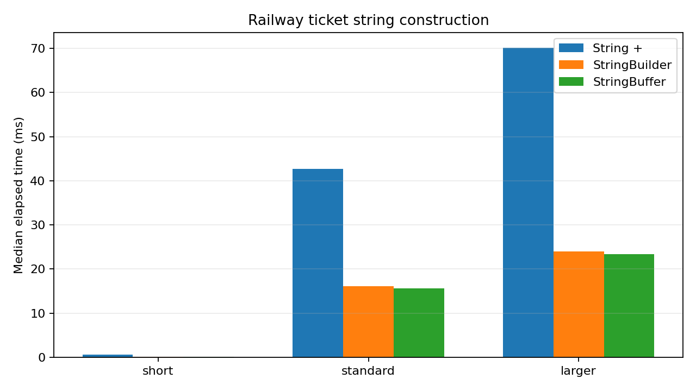

# Q1 — Building railway e-tickets

## Aim and context

Compare repeated `String` concatenation (`+`), `StringBuilder`, and `StringBuffer` while assembling delimiter-separated railway e-ticket fields. The intended workload resembles ticket creation: each ticket is assembled independently from pre-existing field values, then its length and hash are consumed. The benchmark is a single-threaded construction test, not a concurrency test.

## Prediction

`StringBuilder` and `StringBuffer` should scale approximately with the total output size. Repeated `+` should copy an increasingly long prefix for each field, so its work and short-lived string allocation should rise faster as fields per ticket increase. `StringBuffer` may be a little slower than `StringBuilder` because its methods are synchronized, although a single-threaded benchmark cannot measure the value of that synchronization under contention.

## Design and code

`Q1\Q1Benchmark.java` generates each input set before timing. `StringComparison`, `StringBuilderComparison`, and `StringBufferComparison` implement the three builders, and `StringBenchmark` is the run entry point. The workloads are:

| Workload | Tickets | Fields per ticket | Total fields | Output characters |
|---|---:|---:|---:|---:|
| short | 100 | 10 | 1,000 | 21,900 |
| standard | 10,000 | 50 | 500,000 | 10,990,000 |
| larger | 12,000 | 60 | 720,000 | 15,828,000 |

`construct` contains the three equivalent implementations; `run` checks every completed ticket's length and folds its hash into a checksum. The input values and CSV writing are outside the timed section. Each method/workload receives two warm-ups and five measured runs. Method order rotates; `System.nanoTime()` measures one complete workload run. `System.gc()` is requested before each measurement, but the JVM is not required to collect immediately.

CSV columns include every measured duration and checksum, total output length, and process heap used immediately before and after the operation. The heap snapshots are not peak-memory measurements: they can include uncollected garbage and JVM heap expansion. The `estimated_intermediate_strings` column estimates aggregate strings produced by `+` as `tickets × (fields − 1)`; it is zero for the mutable-builder versions, excluding their output strings and internal buffer growth.

## Actual results

Median elapsed time from the five measured runs:

| Workload | String + (ms) | StringBuilder (ms) | StringBuffer (ms) |
|---|---:|---:|---:|
| short | 0.574 | 0.155 | 0.174 |
| standard | 42.719 | 16.128 | 15.663 |
| larger | 70.099 | 23.943 | 23.420 |

The short case is small enough that fixed costs and timing noise are material. At standard scale, `+` took about 2.65× the `StringBuilder` median; at the larger scale it took about 2.93×. `StringBuffer` and `StringBuilder` were close in these single-process measurements. These results do not support claiming a reliable speed difference between the two mutable builders.

All three methods produced the same output length and checksum for every workload and measured run. The generated sample is a ticket such as `T000000-F00=V00000000|T000000-F01=V00000001|...`; console output with the complete first sample for each workload is saved in [`Q1/output.txt`](../Q1/output.txt).

The estimated number of `+` aggregate intermediate strings per run is 900 (short), 490,000 (standard), and 708,000 (larger). Since every generated field is 21 ASCII characters, the corresponding payload copied into those successive aggregate results is approximately 0.118 MB, 279.79 MB, and 482.15 MB respectively if represented as compact one-byte strings. These are theoretical payload totals, not observed live heap or exact allocation counts; object/array headers and JVM optimizations are excluded.

Median process-heap snapshots in bytes (`before → after`), as recorded in the raw CSV:

| Workload | String + | StringBuilder | StringBuffer |
|---|---:|---:|---:|
| short | 1,077,408 → 1,269,056 | 1,077,328 → 1,192,704 | 1,077,168 → 1,190,968 |
| standard | 35,370,896 → 54,267,488 | 35,370,976 → 71,022,768 | 35,371,104 → 71,022,688 |
| larger | 50,478,520 → 127,030,144 | 50,478,360 → 123,878,680 | 50,478,440 → 123,878,760 |

The snapshots vary with collection timing and should not be read as a ranking of peak memory consumption. [`Q1/results.csv`](../Q1/results.csv) preserves all 45 measured rows, including each run's raw heap readings.



## Alternatives and analysis

For already separated fields, Java 17's `String.join("|", fields)` or `StringJoiner` is a concise delimiter-aware alternative; both avoid repeatedly rebuilding a growing immutable prefix. Guava's `Joiner` offers similar convenient null-handling and iterable APIs, but requires an external dependency and was not benchmarked here. `String.format` is useful for formatted/localized values and readable templates, but its format parsing and varargs are unnecessary overhead for simple delimiter joining; it is not a like-for-like replacement in this benchmark.

Strings themselves are immutable and safe to share. `StringBuilder` is mutable and not safe for concurrent unsynchronized access; use one builder per task/ticket or synchronize access if sharing is truly required. `StringBuffer` synchronizes its methods and is suitable for legacy shared-mutation scenarios, but incurs synchronization costs and does not make a multi-call sequence atomic. Garbage collection must reclaim the short-lived concatenation results from the `+` approach; the builder approaches principally allocate each final ticket string plus mutable buffer storage. For this single-threaded ticket workload, a local `StringBuilder` (or `String.join`) is the practical default.

## Complexity and conclusion

Let `k` be fields per ticket and `L` the typical field length. Repeated aggregate `+` copies prefixes of growing length, giving roughly `O(k²L)` work per ticket (`O(tickets × k²L)` overall). A builder appends each delimiter and field with amortized `O(kL)` work per ticket; `StringBuffer` has the same asymptotic construction cost, with synchronization overhead per mutation. The measurements match the predicted scaling advantage for mutable building, but the near-tie between builder implementations is not meaningful evidence about contended multithreaded performance.

For one ticket, the `+` version retains O(kL) output and creates O(k) intermediate strings; `StringBuilder` and `StringBuffer` each use O(kL) buffer/output space. `String.join` and `StringJoiner` require O(kL) output space; `String.format` also uses O(kL) for its output and temporary formatting data. Concatenation has O(k²L) total copying/allocation churn, compared with O(kL) amortized builder appends.

## Reproduce

From the `assignment 2` directory, with Java 17:

```powershell
javac -d Q1\classes Q1\*.java
java -cp Q1\classes StringBenchmark
```

The benchmark writes raw measurements to `outputs\Q1.csv`; the submission copy is [`Q1/results.csv`](../Q1/results.csv), also consolidated as [`experimental-data/Q1-results.csv`](../experimental-data/Q1-results.csv).
