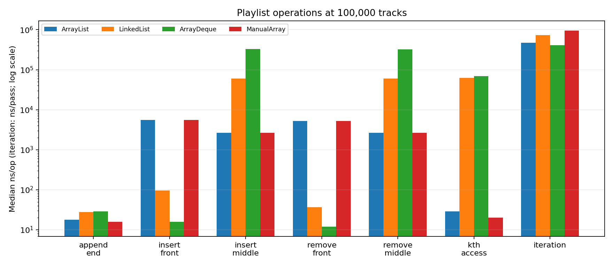

# Q2 — Choosing a playlist collection

## Aim and context

Compare Java's `ArrayList`, `LinkedList`, and `ArrayDeque` for common playlist work, and include a small manually shifted dynamic array for a direct array-layout comparison. A playlist is an ordered sequence: the benchmark appends at the end, inserts/removes at the front and middle, accesses the middle track, and iterates in playlist order.

## Prediction

Array-backed structures should provide fast indexed access and traversal, but inserting/removing away from the end shifts elements. `LinkedList` should favor endpoint edits but pay for node traversal at the middle and for indexed reads. `ArrayDeque` should be strongest at its supported endpoints; it has no indexed middle operation, so the benchmark's compatibility implementation must move elements through a scratch deque. The custom array should have behavior close to `ArrayList`, with array shifts performed explicitly.

## Design and code

The runnable benchmark is `Q2\PlaylistBenchmark.java`; `Playlist.java` and `PlaylistDemo.java` provide the beginner-friendly playlist interface and example. `ArrayListDemo`, `LinkedListDemo`, and `ArrayDequeDemo` show the direct collection operations. The benchmark uses playlist sizes 1,000, 10,000, and 100,000, with the same prebuilt `track-000000`, `track-000001`, … values for every implementation. For each size and operation it performs two warm-up runs and five measured runs, rotating collection order. A fresh, identically populated playlist is made before each timing. `System.nanoTime()` measures 100 operations per trial for each append/insert/remove/access scenario; iteration measures five full passes and reports nanoseconds per pass. Setup and output-file writing are outside the timed interval. Each trial's checksum and final playlist size are validated; all implementation checksums matched across every operation, size, and measured trial.

The `ManualPlaylist` class is a dynamic `String[]` with explicit `System.arraycopy` shifts in `add` and `remove`. Its capacity, like the `ArrayList` and `ArrayDeque` capacities, is reserved before timing, so the append results represent steady-state appends rather than occasional growth/resizing. `ArrayDeque`'s middle insertion/removal are implemented by moving the prefix to a preallocated auxiliary deque, editing the exposed end, then restoring the prefix. This measures the required work to preserve playlist order, but scratch allocation itself is outside the timed interval. The `kth_access` case reads index `n/2`; deque traversal starts from its nearer end.

## Actual results

Median nanoseconds per operation, computed from the five measured trials. `iteration` is nanoseconds per complete pass; all other rows are per single append/edit/access. Bold is intentionally omitted: the benchmark is a small single-process microbenchmark and the results are JVM- and machine-dependent.

### n = 1,000

| Operation | ArrayList | LinkedList | ArrayDeque | ManualArray |
|---|---:|---:|---:|---:|
| Append at end | 115 | 125 | 136 | 205 |
| Insert at front | 517 | 230 | 109 | 144 |
| Insert in middle | 214 | 1,210 | 20,204 | 248 |
| Remove at front | 219 | 200 | 100 | 144 |
| Remove in middle | 82 | 923 | 18,393 | 101 |
| kth access | 18 | 966 | 5,079 | 12 |
| Iteration (per pass) | 8,960 | 10,360 | 7,720 | 3,000 |

### n = 10,000

| Operation | ArrayList | LinkedList | ArrayDeque | ManualArray |
|---|---:|---:|---:|---:|
| Append at end | 13 | 16 | 11 | 27 |
| Insert at front | 300 | 25 | 12 | 285 |
| Insert in middle | 185 | 9,884 | 197,722 | 264 |
| Remove at front | 274 | 16 | 12 | 262 |
| Remove in middle | 176 | 9,293 | 218,198 | 219 |
| kth access | 16 | 9,516 | 42,372 | 6 |
| Iteration (per pass) | 117,700 | 162,840 | 133,180 | 63,920 |

### n = 100,000

| Operation | ArrayList | LinkedList | ArrayDeque | ManualArray |
|---|---:|---:|---:|---:|
| Append at end | 18 | 28 | 29 | 16 |
| Insert at front | 5,564 | 95 | 16 | 5,604 |
| Insert in middle | 2,677 | 60,266 | 332,041 | 2,676 |
| Remove at front | 5,204 | 37 | 12 | 5,219 |
| Remove in middle | 2,634 | 59,655 | 321,799 | 2,668 |
| kth access | 29 | 62,706 | 69,368 | 20 |
| Iteration (per pass) | 468,380 | 728,140 | 410,420 | 950,840 |

At 100,000 elements, the endpoint operation advantage of `LinkedList` and `ArrayDeque` is clear for front insert/remove compared with array shifting. `ArrayList` and `ManualArray` lead for middle edits and kth access in this workload, while the deque's compatibility middle edit is slow because it must move a large prefix. ArrayDeque traversal was fastest in the 100,000-element iteration case, while the custom array was faster at the two smaller sizes. These small-run iteration differences should not be overgeneralized. The complete raw output, including every trial's duration and checksum, is in [`Q2/results.csv`](../Q2/results.csv); captured console medians are in [`Q2/output.txt`](../Q2/output.txt).



## Complexity, alternatives, and conclusion

| Structure | Append end | Insert/remove front | Insert/remove middle | kth access | Iterate | Notes |
|---|---|---|---|---|---|---|
| `ArrayList` | Amortized O(1) | O(n) | O(n) | O(1) | O(n) | General-purpose ordered list; shifts contiguous references. |
| `LinkedList` | O(1) | O(1) | O(n) to locate, O(1) relink | O(n) | O(n) | Endpoint edits are cheap, but each element has node/link overhead. |
| `ArrayDeque` | Amortized O(1) | Amortized O(1) | Not supported natively; this benchmark emulates it in O(n) time and O(n) scratch space | O(n) by traversal | O(n) | Best fit for endpoint-focused deque behavior, not arbitrary playlist edits. |
| `ManualArray` | Amortized O(1) | O(n) | O(n) | O(1) | O(n) | Explicitly grows a `String[]` and shifts entries with `System.arraycopy`. |

| Operation | ArrayList | LinkedList | ArrayDeque | Time complexity | Auxiliary space |
|---|---|---|---|---|---|
| Append at end | Amortized O(1) | O(1) | Amortized O(1) | O(1) amortized | O(1) per insertion; occasional array growth may copy O(n) |
| Insert at front | O(n) shift | O(1) at head | Amortized O(1) | O(n), O(1), O(1) respectively | O(1) extra; each structure stores O(n) playlist elements |
| Insert at middle | O(n) shift | O(n) locate, O(1) link | No indexed operation; emulation O(n) | O(n) | O(1) extra for array/list; O(n) scratch for deque emulation |
| Remove from front | O(n) shift | O(1) | Amortized O(1) | O(n), O(1), O(1) respectively | O(1) extra |
| Remove from middle | O(n) shift | O(n) locate, O(1) unlink | No indexed operation; emulation O(n) | O(n) | O(1) extra for array/list; O(n) scratch for deque emulation |
| Access k-th element | O(1) | O(n) | O(n) traversal | O(1), O(n), O(n) respectively | O(1) extra |
| Iterate all tracks | O(n) | O(n) | O(n) | O(n) | O(1) iterator space |

For a playlist dominated by random reads, iteration, and occasional edits, use `ArrayList`; it is simple, compact, and its indexed operations are constant time. Prefer `ArrayDeque` when the playlist is really a queue/deque with edits concentrated at its ends. `LinkedList` is reasonable when endpoint edits dominate and indexed access is rare, though its pointer chasing and per-node memory use can outweigh its asymptotic advantage. A custom shifted array is useful pedagogically but usually offers no benefit over `ArrayList`.

Other choices depend on requirements: `Vector` also shifts for indexed edits and synchronizes individual methods; `CopyOnWriteArrayList` is useful for read-mostly concurrent collections but copies on each write (O(n)); a bounded `ArrayBlockingQueue` fits concurrent FIFO work, not a random-access playlist. If arbitrary middle insertion/removal is frequent at much larger sizes, a purpose-built indexed tree or segmented sequence may be preferable, at the cost of more complexity.

## Reproduce

From the `assignment 2` directory, with Java 17:

```powershell
javac -d Q2\classes Q2\*.java
java -cp Q2\classes CollectionBenchmark
```

The benchmark writes raw measurements to `outputs\Q2.csv`; the submission copy is [`Q2/results.csv`](../Q2/results.csv), also consolidated as [`experimental-data/Q2-results.csv`](../experimental-data/Q2-results.csv).
