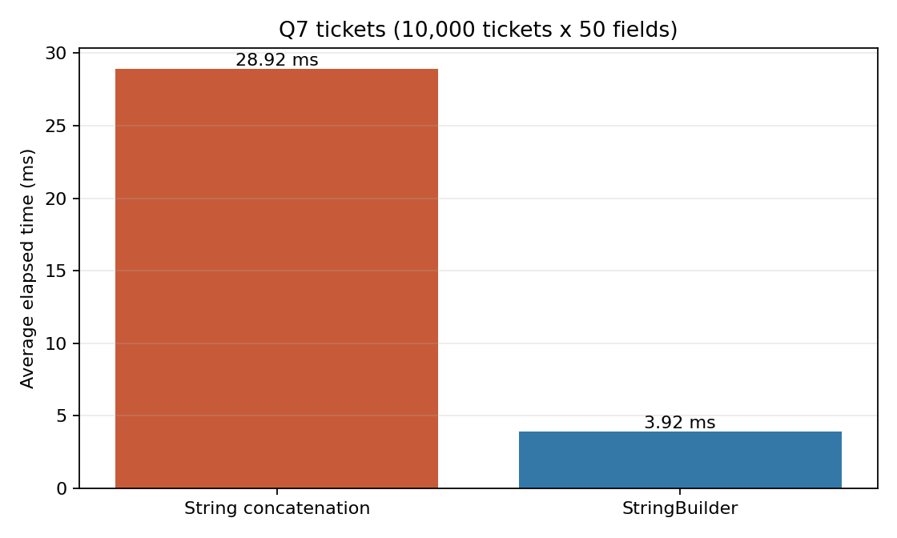

# Q7 - Day-4 Design Challenge

## Aim and problem context
Use experimental evidence from Q1-Q6 to identify a real bottleneck, make a measurable design change, and test the original and revised implementations on the same input. Q1 and this controlled Q7 comparison use repeated immutable `String` concatenation to assemble railway-ticket fields versus `StringBuilder`.

## A. Diagnose the bottleneck
Each ticket is built by repeatedly applying `ticket += field`. Because `String` is immutable, each append copies the content accumulated so far and creates another string. For the Q7 workload, one run creates 10,000 tickets with 50 fields each (500,000 appends). The measured baseline is shown below and recorded in [`results.csv`](../Q7/results.csv).

## B. Design objective and initial prediction
Objective: preserve byte-for-byte ticket content while reducing average construction time by at least 50% for 10,000 tickets with 50 fields each. Prediction: a local `StringBuilder` will meet the target by accumulating fields in a mutable buffer and creating the final string once per ticket.

## C. Revised design
- **Original:** start with an empty immutable string and append each field using `+`.
- **Revised:** create one `StringBuilder` per ticket, append the same fields in the same order, and call `toString()` once.
- Both implementations receive the same immutable field list and create the same number of tickets. A direct comparison checks that one built ticket is identical before timing starts.
- This optimizes single-threaded ticket construction. A `StringBuilder` should not be shared concurrently; shared log output should use a synchronized logger, a lock, or another thread-safe logging strategy.

## D-E. Experimental procedure and actual results
The actual workload used 50 fields and 10,000 tickets. Both implementations ran two warm-ups and five measured repetitions on the same Java 17 process. Timing uses `System.nanoTime()` around only the ticket-building work; CSV writing and console output are outside the timed interval. No explicit garbage collection is requested between measurements. Heap values are used-heap snapshots before and after each run and are noisy indicators, not a measurement of total allocated bytes.

| Implementation | Repetitions | Average time (ms) | Field appends/run | Content check |
|---|---:|---:|---:|---|
| String concatenation | 5 | 28.922 | 500,000 | Pass |
| StringBuilder | 5 | 3.921 | 500,000 | Pass |

Measured improvement: **86.44%** in average elapsed time, calculated as `(28.922 - 3.921) / 28.922 * 100`. Thus the prediction was met for this measured machine and run. Individual observations and before/after used-heap samples are in [`results.csv`](../Q7/results.csv); the actual console summary is in [`output.txt`](../Q7/output.txt).

Q1 independently measured a standard 10,000-ticket, 50-field workload at a 42.719 ms median for concatenation versus 16.128 ms for `StringBuilder`; this supports investigating the immutable-prefix copying as a real bottleneck. Q7 then repeated a controlled same-data comparison for that workload family. Timings are local observations, not portable guarantees: JIT compilation, garbage collection, machine load, heap configuration and JVM version all influence results.

## F. Analysis, alternatives and trade-offs
The measured objective was achieved and the direct content comparison passed. For a ticket with F fields, immutable concatenation copies partial results repeatedly (O(F²) copied characters for similarly sized fields); a builder performs O(F) append operations, amortized, and produces the final text. For T tickets the corresponding work is O(TF²) versus O(TF), assuming bounded field lengths. The output itself occupies O(TF) space. A builder temporarily holds one ticket in O(F) field references/characters plus its result string.

`StringBuilder` is preferred for local, single-threaded assembly. `StringBuffer` synchronizes individual operations and can be useful when the same mutable buffer truly must be shared, but synchronization alone does not make a multi-operation transaction atomic. A logger is generally preferable for shared logging. `String.join` and `StringJoiner` express delimiter-separated output clearly; `String.format` is convenient for formatted templates but is not usually the most efficient repeated high-volume concatenation.

The original approach remains reasonable for a few short, fixed concatenations: it is easy to read and avoids mutable builder state. For very long output streams, buffering and writing incrementally may avoid retaining every completed ticket in memory.

## Complexity
- Original construction: O(F²) copied characters per ticket for similarly sized fields; O(F) retained output and intermediate strings for one ticket, with higher total allocation churn.
- Revised construction: O(F) append operations per ticket (amortized); O(F) builder/output space per ticket.
- Whole workload: O(TF²) versus O(TF) time under the same field-size assumption; O(TF) if all resulting ticket strings are retained, or O(F) temporary construction space when only one ticket is held at a time.

## Result
The measured redesign preserves ticket contents and improves the average time by 86.44% for this workload. The target was met; report the actual CSV values rather than generalizing this single-machine experiment to every workload.
