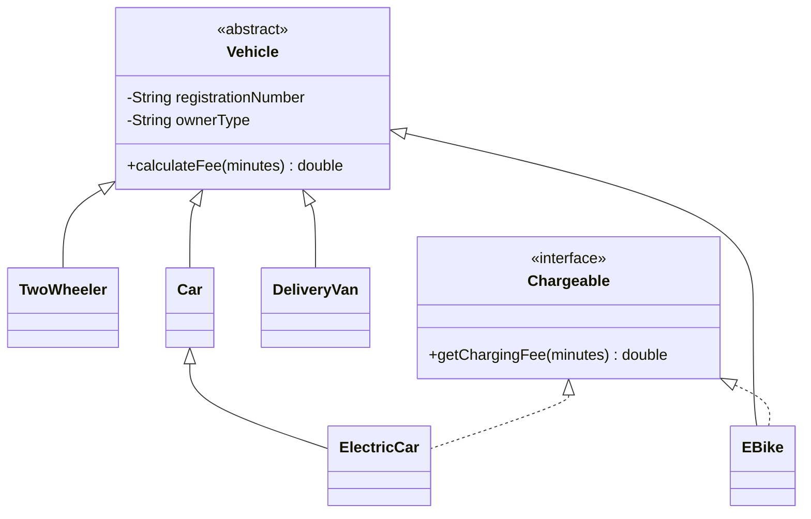

# Task 06 - Inheritance

## Aim
Reuse common vehicle identity while representing specialized vehicles.

## UML class diagram

## Constructor execution trace
Creating `new TwoWheeler("TN10X1", "STAFF")` first enters the two-argument `TwoWheeler` constructor, invokes `super(registrationNumber, ownerType)`, executes the `Vehicle` constructor and field initialization, then completes the subclass constructor. The one-argument form first calls `this(registrationNumber, "VISITOR")`, which follows the same sequence.

## Explanation and alternatives
Inheritance makes common identity and contract (`calculateFee`) consistent while each subtype supplies its rate. Composition could instead store a `VehicleType` or `PricingStrategy` in a generic vehicle. That avoids a growing subclass tree and is easier when behaviour varies independently, but is less direct for demonstrating the required hierarchy. The chosen hierarchy is modest and clear.

## Complexity
Constructing a vehicle is O(1) time and space. Fee dispatch is O(1), apart from the delivery van's per-billed-hour time scan (O(H) for H billed hours).

## Result
The required inheritance tree is implemented in [`parking.model`](../src/parking/model), with the electric car inheriting car behaviour.
